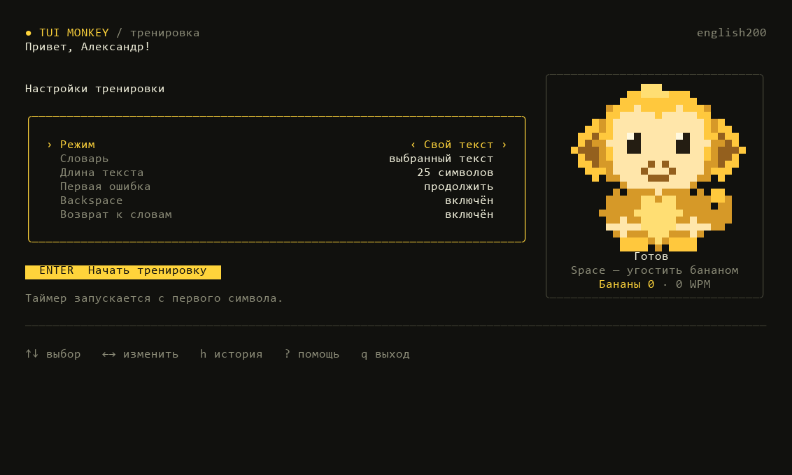

# TUI Monkey

Тренажёр печати для терминала и VS Code.

## Установка

Нужен Node.js 22+. Windows, Linux, macOS — Apple Silicon и Intel.

```sh
npm install -g tui-monkey
tui-monkey
```

Без установки: `npx tui-monkey`.

## Пример работы



## Возможности

- Тренировки по словам, времени или собственному тексту.
- 39 словарей, включая русский и языки программирования.
- Скорость, точность, ошибки и график результатов.
- Повтор слов с ошибками и ограничения исправлений.
- История завершённых и прерванных сессий, удаление отдельных записей.
- Пиксельная обезьяна с реакциями на ввод.
- Интерфейс подстраивается под размер терминала.
- Приветствие использует имя из VS Code, Git или системы.

## Управление

| Клавиша | Действие |
| --- | --- |
| ↑ / ↓ | Выбрать настройку или запись истории |
| ← / → | Изменить настройку |
| Enter | Начать или повторить тренировку |
| Tab / Ctrl+R | Перезапустить тренировку |
| Backspace / Ctrl+W | Стереть символ / слово |
| R | Повторить ошибочные слова после теста |
| Space | Угостить обезьяну в меню |
| H / ? | История / помощь |
| D / Delete | Удалить выбранную запись истории |
| Esc | Главное меню |
| Ctrl+C | Сохранить прерывание и выйти |

Таймер начинается с первого символа. Вставка блоков текста отключена.
Прерванные сессии учитываются в общих показателях. Во время тренировки
результат сохраняется примерно раз в секунду; при обычном выходе — сразу.

## Параметры

```sh
tui-monkey --words 50 --language russian
tui-monkey --time 60 --language go
tui-monkey --text-file example.txt
tui-monkey --language-file words.txt
tui-monkey --sudden-death --no-backspace
tui-monkey --history
```

Полный список: `tui-monkey --help`.

## VS Code

Установите VSIX своей платформы через **Extensions: Install from VSIX**.
Запуск: **TUI Monkey: Start Typing** в палитре команд.
Для выделенного текста: **TUI Monkey: Practice Selected Text**.

## Разработка

Go 1.23+, Bun 1.3.12+. Интерфейс — TypeScript, React/Ink и Yoga;
проверка данных — Zod.

```sh
bun install
bun run dev
bun run check
bun run test
bun run build
bun run package
bun run build:npm
bun run pack:npm
```

VSIX и npm-архивы собираются в `artifacts/`.
GitHub Actions проверяет Windows, Linux, macOS Intel и Apple Silicon.

## Данные

История хранится в `~/.tui-monkey/history/`, без введённого текста.
Старый `history.json` также читается. Отправки данных нет.
`TUI_MONKEY_DATA_DIR` меняет каталог, `TUI_MONKEY_NAME` — имя приветствия.

WPM считается по верным символам: символы / 5 / минуты.
Средняя скорость учитывает длительность всех сессий, точность — число нажатий.
Удалённая запись больше не влияет на статистику.
